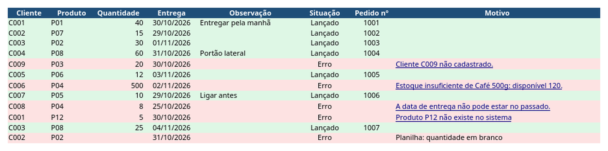
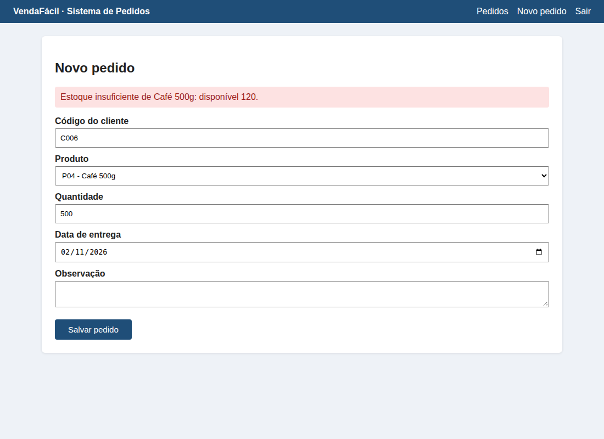
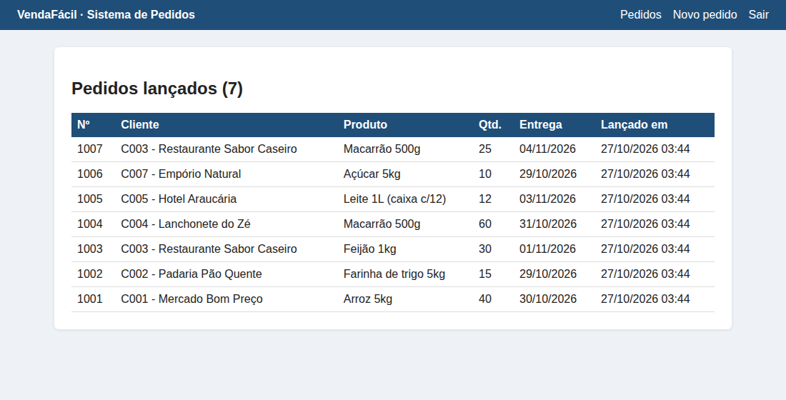

# Robô de Lançamento de Pedidos (RPA)

Um robô que faz o trabalho repetitivo de **digitar pedidos de uma planilha Excel num sistema web**: entra no sistema, preenche a tela de cada pedido, clica em salvar e anota na própria planilha o que deu certo e o que deu errado, e por quê.



## O problema

Em muitas empresas alguém passa horas copiando dados de uma planilha para dentro de um sistema, campo por campo. É lento, cansativo e sujeito a erro de digitação. Quando o sistema recusa um registro, a pessoa precisa anotar à parte o que faltou lançar.

**RPA** (automação robótica de processos) é colocar um robô para fazer essa digitação, usando o sistema pela tela, exatamente como uma pessoa faria. Não precisa mexer no sistema da empresa nem ter acesso ao banco de dados.

## Como funciona

1. A pessoa preenche a planilha de pedidos, como já faz hoje.
2. O robô entra no sistema e lança os pedidos, um por um.
3. Na **própria planilha**, ele acrescenta três colunas: **Situação**, **Pedido nº** e **Motivo**, e pinta cada linha de verde (lançado) ou vermelho (erro).
4. A pessoa corrige as linhas vermelhas ali mesmo e roda o robô de novo. **As linhas verdes são puladas**: um pedido nunca é lançado duas vezes.

Não existe planilha de relatório separada: é uma planilha só, do começo ao fim.

## Os cuidados de um robô de verdade

| Situação | O que o robô faz |
|---|---|
| **Sistema recusou o pedido** (cliente não cadastrado, estoque insuficiente, data vencida) | Anota a mensagem do sistema como motivo, tira um **print da tela** e segue para o próximo pedido |
| **Campo em branco na planilha** | Nem vai ao sistema: anota "quantidade em branco" e segue |
| **Produto que não existe na lista do sistema** | Percebe antes de salvar e anota o motivo |
| **Sistema lento ou que não respondeu** | Espera a resposta e, se não vier, tenta de novo uma vez |
| **A sessão caiu no meio** | Entra no sistema de novo e continua |
| **Rodou duas vezes a mesma planilha** | Pula o que já foi lançado |
| **Planilha aberta no Excel** | Avisa para fechar antes, em vez de perder o resultado |
| **Antes de gravar na planilha** | Guarda uma cópia de segurança em `entrada/backup/` |

Tudo fica registrado em `saida/robo.log`, com data e hora. Clicando no motivo de um erro, abre o print da tela daquele momento:



## O sistema de demonstração

Para mostrar o robô sem usar o sistema de uma empresa real, o projeto traz o **VendaFácil**, um sistema de pedidos de mentira que roda só no seu computador. Ele tem login, lista de pedidos e uma tela de cadastro que valida os dados como um sistema real.



Num trabalho real, o robô aponta para o sistema do cliente, e só a parte que preenche a tela é adaptada.

## Como rodar

O robô funciona no **Windows, Mac e Linux**. É preciso ter o [Python](https://www.python.org/downloads/) 3.10 ou mais novo instalado (no Windows, marque "Add python.exe to PATH" na instalação).

Depois, é só dar **dois cliques** no atalho do seu sistema:

| Sistema | Atalho |
|---|---|
| Windows | `rodar_robo.bat` |
| Mac | `rodar_robo.command` |
| Linux | `rodar_robo.sh` |

Na primeira vez o atalho prepara tudo sozinho (leva alguns minutos). Nas próximas, só roda. A janela do navegador abre e dá para acompanhar o robô trabalhando.

Para quem prefere o terminal:

```bash
python3 -m venv .venv
source .venv/bin/activate          # no Windows: .venv\Scripts\activate
pip install -r requirements.txt
playwright install chromium
python gerar_dados.py              # cria a planilha de exemplo
python robo.py --demo --mostrar    # --demo liga o VendaFácil; --mostrar abre o navegador
```

## Entrega para o cliente

- **Programa pronto:** o robô pode ser entregue como um programa único (um `.exe` no Windows), que o cliente abre sem instalar Python, e pode usar o Chrome ou o Edge que já estão no computador.
- **Usuário e senha** ficam num arquivo de configuração do computador do cliente (variáveis `ROBO_ENDERECO`, `ROBO_USUARIO` e `ROBO_SENHA`), nunca dentro do programa.
- **Agendamento:** o robô pode rodar sozinho todo dia, no horário combinado, pelo Agendador de Tarefas do Windows ou equivalente no Mac e no Linux.

## Estrutura

```
robo-pedidos/
├── entrada/           planilha de pedidos (o exemplo é criado na primeira vez) e backups
├── saida/             log e prints dos erros
├── sistema/           VendaFácil, o sistema de demonstração
├── robo.py            o robô
├── formatar.py        anota o resultado e as cores na planilha
├── gerar_dados.py     cria a planilha de exemplo
├── rodar_robo.*       atalhos de dois cliques (Windows, Mac, Linux)
└── requirements.txt   bibliotecas necessárias
```

## Tecnologias

Python, [Playwright](https://playwright.dev/python/) (controla o navegador), pandas e openpyxl (planilha), Flask (sistema de demonstração).

## Sobre

Projeto de portfólio de **Gilmar Alberto de Abreu Pinto**, analista de sistemas em Curitiba, inspirado em pedidos reais de clientes. Os dados são fictícios. Desenvolvido com apoio de IA (Claude).

**Tem uma digitação repetitiva que poderia ser feita por um robô?** Me contrate pela plataforma que você já usa:

- [99Freelas](https://www.99freelas.com.br/user/GilmarAlberto)
- [Workana](https://www.workana.com/freelancer/1ccbe3135f7ebb6a82b57c41ea77d535)
